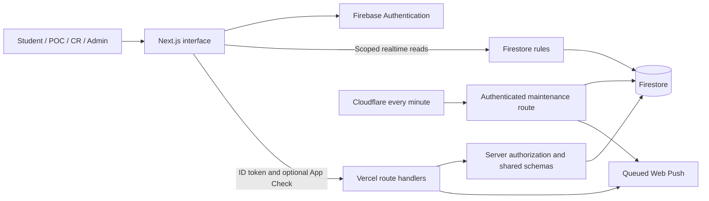
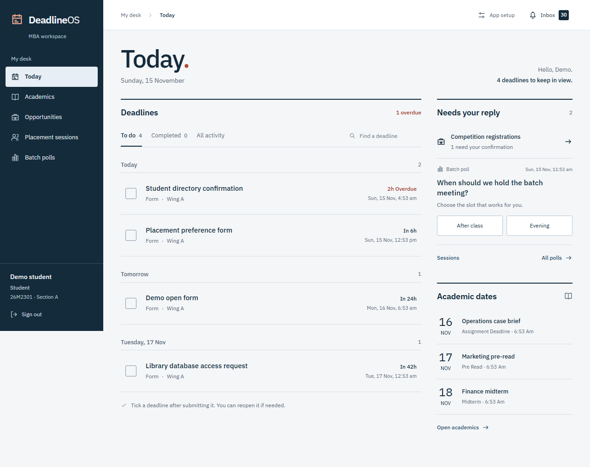
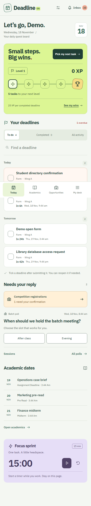
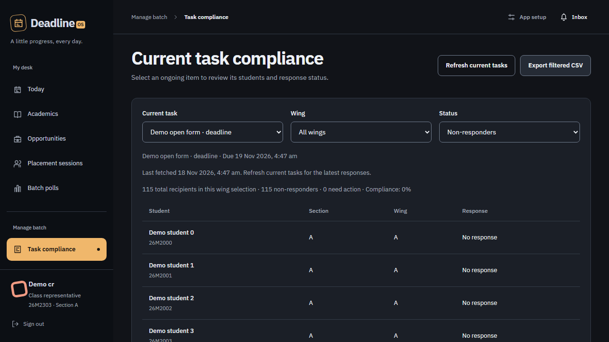
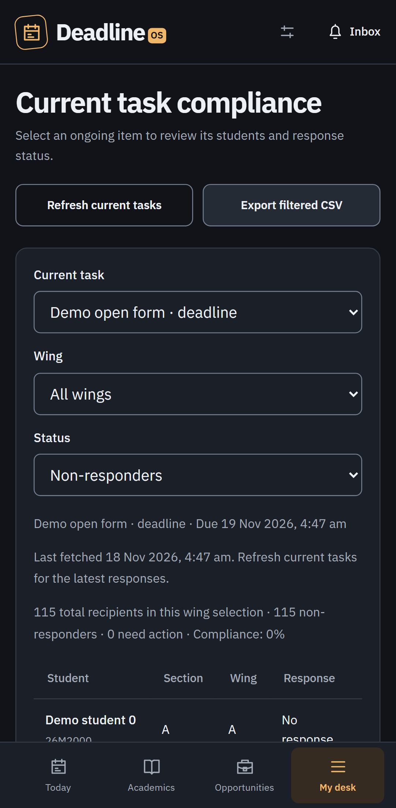
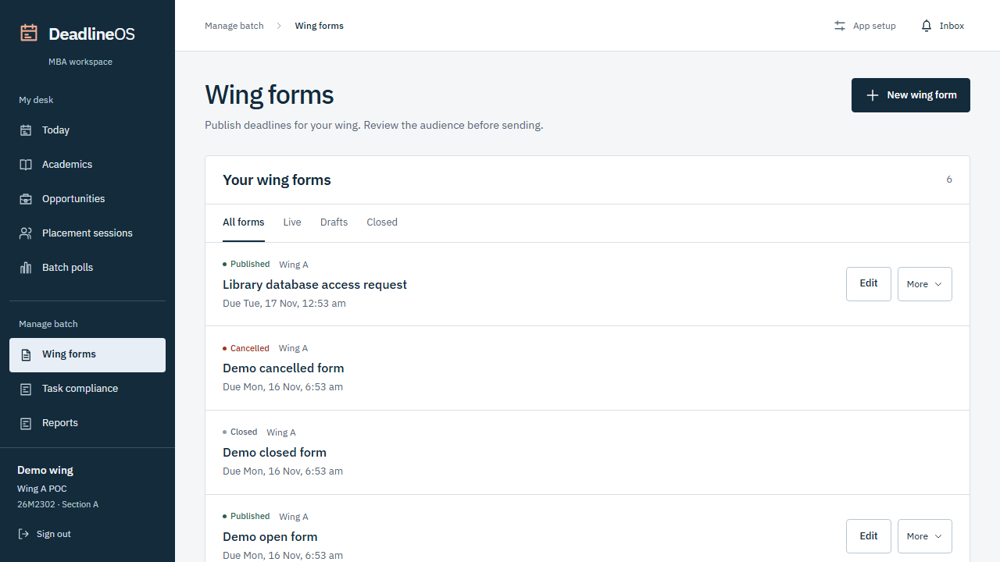
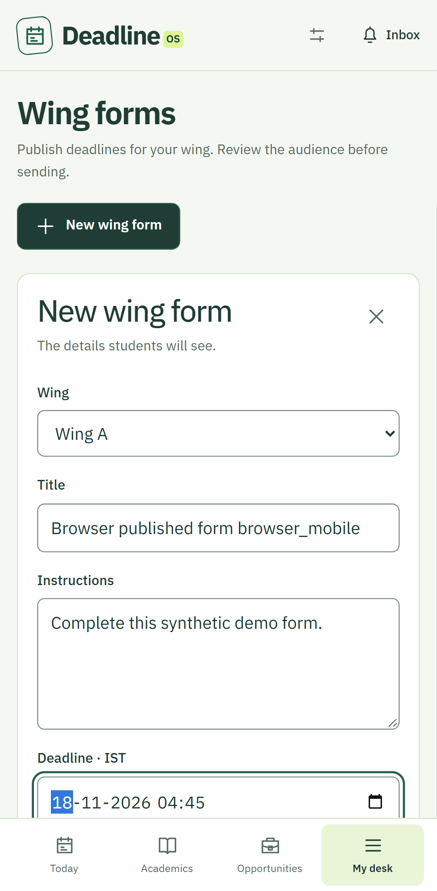

# Presenting DeadlineOS

DeadlineOS coordinates academic dates, administrative forms, opportunities and batch responses for an MBA cohort. Its main technical story is the lifecycle of an obligation: a scoped manager publishes it, the right student receives it, and an authorized representative reviews the response.

## Full presentation

Use [the full feature runbook](PRESENTATION_RUNBOOK.md) for the 14-minute quick path and longer reference order, exact sample records, expected outcomes and cleanup boundaries. The same ten-step checklist is built into System admin.

## Prepare a repeatable demonstration

Use a dedicated demo Firebase project or the local emulators. From System admin, use Presentation workspace > Prepare 15-minute demo. Copy the generated credentials and open separate browser profiles for Student, Subject POC, Wing A POC and CR. The two Section B identities demonstrate section scope and placement eligibility. Refreshing the seed preserves existing passwords; password reset is a separate explicit action. Never use a real roster for a portfolio demo.

The automated browser fixtures are also entirely synthetic. They exercise Student, Wing POC, CR and Admin accounts on desktop and mobile. Run `npm run test:emulators` after installing the Playwright browser with `npx playwright install chromium`.

## Five-minute walkthrough

1. Open Today. Show the To do, Completed and All activity views and Find a deadline search. Explain the deadline rows, Needs your reply and Academic dates. On mobile, use My desk to find the remaining student and management tools.
2. Sign in as Wing POC. Open Wing forms, select New wing form, preview its audience and publish. Explain that publication creates assignments, inbox notifications and deterministic reminder jobs atomically. Use Edit to change the deadline and More to synchronize its audience.
3. In the Student session, mark the form complete, reopen it, then complete it again. Open the inbox and show its scroll and keyboard behavior.
4. In the CR session, open Task compliance, select that form, filter by wing/status and export CSV. With a larger audience, load all response pages before exporting exact totals.
5. Show the Competitions and Internships tabs in Opportunities: separate external and internal competition confirmations, plus internship registration/no-participation. In Admin, edit and cancel a synthetic internship.
6. Close the form as Wing POC. Confirm it leaves the Student active queue and remains visible as closed in history.

## What to say about scope

- Academic dates and exams are informational calendar events with change notifications; they do not use wing-task completion controls or the same timed reminder pipeline.
- Competition participation uses two individual confirmations. Legacy team/round implementations are retained in source but are not part of the current UI/API product.
- Push is opt-in per device. Real delivery depends on device/browser support and the deployed HTTPS setup.
- The current product models one batch, Sections A/B, Wings A–J and India time. Elective enrollment is not modeled.

## Explain the engineering

Useful tradeoffs to discuss: server-only writes simplify authorization; assignment snapshots make dashboards fast; deterministic jobs support retry safety; paginated current-item reporting controls read cost; transaction limits bound atomic operations; free hosting and push delivery require operational monitoring.

## Screenshots

These captures are generated from the local emulator browser smoke tests using synthetic data.

## Interface direction

The academic register uses cream pages, a deep vermilion identity rail, expressive Fraunces headings, IBM Plex Sans for interface data and a live India-date stamp. Students begin with obligations; managers begin with current records and open editors deliberately. Completing a deadline changes its outlined control to a filled check, with reduced-motion support. The same vocabulary and role permissions apply on mobile. See [the design system](../DESIGN.md).

